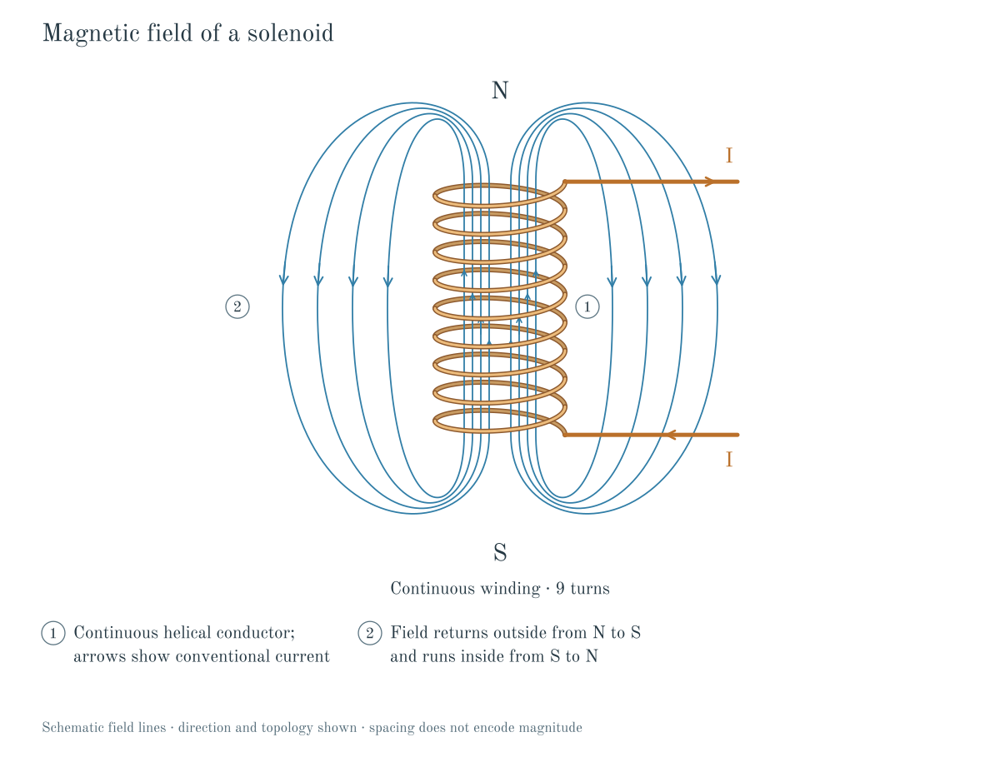

# Kinetra Codex Plugin

Local-first technical learning workbench for Codex. This plugin exposes
seven skills, including a self-contained Python textbook-diagram renderer and
skills that route into Kinetra's deterministic TypeScript core for
Karnaugh maps, DC/transient circuit analysis, physics diagrams, lexical
+ vector retrieval, study-plan generation, and quiz/exam generation.

The diagram skill also supports shaded charged-rod apparatus illustrations,
including attraction and repulsion. Run `npm run diagram` or
`npm run examples:diagrams` from the repository root. Supported physics models
and their limits are documented in [the diagram guide](../../docs/diagrams.md).
Deterministic output is not a guarantee that a user-supplied physical model is correct.

For straight-wire fields, solenoids and reactor cutaways, use
[`kinetra-textbook-diagrams`](skills/kinetra-textbook-diagrams/SKILL.md). Its
scripts, font, JSON examples and reviewed references travel with the skill.
Copy that entire folder into your Codex skills directory, or import this plugin
to include it alongside the existing skills. Python dependencies are required;
see the skill's setup instructions. Existing TypeScript skills still require
the repository source.



When no available specialized skill covers a requested static technical figure,
the diagram skill provides a custom SVG/3D illustration fallback. It requires
independent technical checks and inspection of the final render for overlaps,
clipping, attachments, perspective, and shading. This authoring workflow does
not add new physics solvers or guarantee flawless output for arbitrary inputs.

## Layout

```
packages/plugin/
+- .codex-plugin/
|  +- plugin.json          # Codex plugin manifest
+- assets/
|  +- kinetra-icon.svg     # composer icon
|  +- kinetra-logo.png     # logo
+- skills/
|  +- kinetra-kmap/        # Boolean minimization, Karnaugh maps
|  +- kinetra-circuits/    # DC + transient circuit solver + schematic
|  +- kinetra-diagrams/    # 2D physics diagrams (FBD, projectile, pulley, optics, fields)
|  +- kinetra-textbook-diagrams/ # Portable renderer, font, examples and visual checks
|  +- kinetra-retrieval/   # Hybrid lexical + vector retrieval, benchmark
|  +- kinetra-study-plan/  # Ingest -> chunk -> mastery -> spaced study plan PDF
|  +- kinetra-assess/      # Quiz / exam / flashcard generation with mastery
|  +- kinetra-compose/     # Custom diagrams composed from toolkit parts, with checks
+- test/
|  +- plugin_structure.test.ts   # node --test self-tests for the plugin manifest + skills
+- README.md
```

## Skills

| Skill | Purpose | Triggers on |
| --- | --- | --- |
| `kinetra-kmap` | Build a 2-4 variable K-map, simplify SOP/POS, render truth table | user asks to minimize a Boolean expression, build a K-map, or verify a truth table |
| `kinetra-circuits` | Solve DC operating point and transient for RC/RL/RLC circuits with the pure-TS SPICE-lite solver | user describes an RC/RL/RLC/RLC+source circuit and asks for V(t), I(t), or a schematic |
| `kinetra-diagrams` | Render a 2D physics diagram (free body, projectile, pulley, optics, fields) to SVG | user describes a physics setup and wants a labeled diagram |
| `kinetra-textbook-diagrams` | Render measured, checked magnetic-field illustrations and reactor cutaways | user wants a straight-wire field, solenoid, or reactor-loop illustration |
| `kinetra-retrieval` | Ingest a local corpus, build a hybrid (lexical + vector) index, run benchmark | user wants to query local lecture notes, papers, or transcripts |
| `kinetra-study-plan` | Build a spaced-repetition study plan PDF from a topic list, track mastery over time | user wants a study plan, syllabus tracker, or revision schedule |
| `kinetra-assess` | Generate quiz / exam / flashcards from topics, score attempts, update mastery | user wants practice questions, an exam, or flashcards for a topic |
| `kinetra-compose` | Compose a custom engineering diagram from toolkit parts with declared physics checks and an overlap gate | no Kinetra template fits the figure the user needs |

## How to test

From the repo root:

```bash
node --test --experimental-strip-types packages/plugin/test/plugin_structure.test.ts
```

This validates the manifest, the skill folders, the YAML frontmatter, the
`agents/openai.yaml` UI metadata, the assets, and that every skill
description is non-empty and unique.

Run `npm run test:textbook` after installing the Python requirements. This runs
geometry, parameter, raster-regression and isolated-packaging checks. It is a
separate suite from the Node tests and requires the dependencies listed in the
textbook skill. Baseline update instructions live in that skill; do not update
reference images merely to silence a regression.
